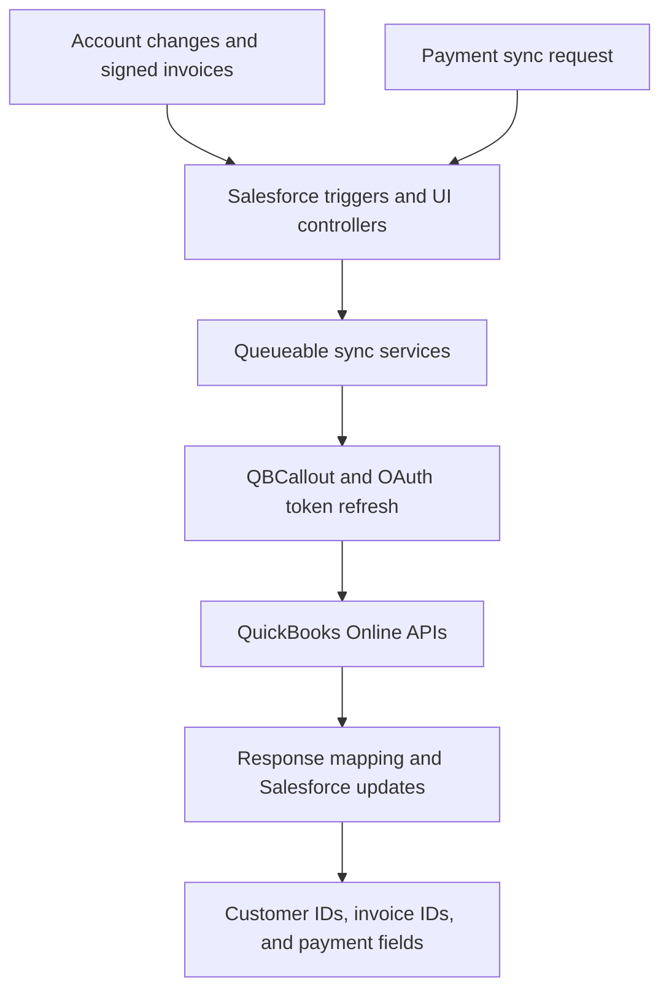

# Salesforce and QuickBooks Online Integration

A Salesforce–QuickBooks Online integration that connects customer records, signed invoices, and payment information through Apex REST API callouts. Salesforce Accounts are synchronized to QuickBooks Customers, signed Salesforce invoices initiate invoice creation in QuickBooks, and QuickBooks payment details are synchronized back to Salesforce.

This README describes the project architecture documented in the technical design document. It does not include the Apex source code or deployable Salesforce metadata; deployment and test execution require those artifacts.

## Business purpose

The integration automates the transfer of customer and invoice information between sales and accounting systems and makes payment information available in Salesforce. It supports a connected customer-to-invoice-to-payment workflow with less manual data entry.

## Core workflows

| Workflow | Direction | Initiation | Result |
| --- | --- | --- | --- |
| Customer synchronization | Salesforce → QuickBooks | Account create/update with the QB Sync checkbox selected | Synchronizes an Account with a QuickBooks Customer and stores integration identifiers |
| Invoice creation | Salesforce → QuickBooks | Invoice Signed Status changes to Signed | Creates a QuickBooks invoice and stores the returned identifiers |
| Payment synchronization | QuickBooks → Salesforce | Salesforce payment-sync action or trigger with the configured QB Sync selection | Retrieves payment information and updates the related Salesforce invoice |

Payment synchronization uses QuickBooks API queries. The documented design does not establish a webhook listener or a scheduled polling interval.

## Technology stack

- Salesforce Apex and Apex triggers
- Queueable Apex for asynchronous integration processing
- QuickBooks Online REST APIs
- OAuth 2.0 access tokens and refresh-token exchange
- JSON request models and response wrappers
- Salesforce custom objects, Custom Metadata, and Custom Settings
- Remote Site Settings for permitted callout endpoints

## Architecture

### Customer synchronization

1. A Salesforce Account is created or updated with QB Sync selected.
2. `QBAccSyncTrigger` initiates the customer synchronization workflow.
3. `QBCustomerSyncService` performs asynchronous processing.
4. Field mapping and JSON models prepare the QuickBooks Customer payload.
5. `QBCallout` handles the API request, endpoint, headers, and token handling.
6. The response is mapped back to Salesforce, including the QuickBooks Customer ID and sync token.

### Invoice creation

1. A Salesforce invoice transitions to the Signed status.
2. `QBInvSyncTrigger` initiates `QBInvoiceSyncService`.
3. The service prepares the QuickBooks invoice payload and invokes the API through `QBCallout`.
4. The returned QuickBooks Invoice ID and sync token are stored on the Salesforce invoice.

### Payment synchronization

1. The configured Salesforce payment synchronization entry point initiates `QBPaymentSyncService`.
2. QuickBooks payment and payment-method queries retrieve accounting details.
3. Payment references, including `LinkedTxn` and `TxnId`, associate payments with invoices.
4. Salesforce invoice fields are updated with payment status, payment ID, paid amount, payment date, and payment-method information.

## Salesforce data model

Field names below are descriptive labels from the design document. Except for the documented `Invoice__c` object, exact custom API names must be confirmed from the Salesforce metadata.

| Component | Key configuration or fields | Purpose |
| --- | --- | --- |
| `QuickBooksAuth` Custom Metadata | Base URL, Company/Realm ID, Minor Version | Environment and API configuration |
| `QBData` Custom Setting | Client ID, Client Secret, Refresh Token, Auth URL, Last Updated | Authentication configuration and refresh-token tracking |
| Account | QuickBooks ID, QB Online Sync Token, QB Sync | Customer association and synchronization control |
| `Invoice__c` | QuickBooks ID, QB Online Sync Token, Due Date, Signed Status, Amount, Opportunity lookup, Description | Invoice details and QuickBooks association |
| `Invoice__c` payment fields | QB Payment ID, Payment Status, Payment Type, Payment Name, Paid Amount, Last Payment Date | Payment visibility in Salesforce |

QuickBooks ID fields are documented as Unique External IDs. QuickBooks sync tokens track record versions for updates.

## Apex components

| Component | Responsibility |
| --- | --- |
| `QBCallout` | Shared HTTP callout handling, headers, tokens, and endpoints |
| `QBCustomerSyncService` | Queueable customer synchronization |
| `QBInvoiceSyncService` | Queueable invoice creation after signature |
| `QBPaymentSyncService` | Queueable retrieval and synchronization of payment details |
| `QBCustomerSync_Controller` | Manual customer synchronization actions |
| `QBInvoice_Controller` | Manual invoice synchronization actions |
| `QBMap` | Salesforce-to-QuickBooks field mapping |
| `QBException` | Custom integration exception handling |
| `CheckRecurssive` | Protection against recursive trigger execution during sync updates |
| `QBCustomerJSON`, `QBCustomerResponseJSON` | Customer request and response models |
| `QBInvoiceJSON`, `QBInvoiceQueryJSON`, `QBInvoiceResponseJSON` | Invoice request and response models |
| `QBPaymentQueryJson`, `QBPaymentMethodQueryJson` | Payment and payment-method response models |
| `QBRefreshJSON` | OAuth token-refresh response model |
| `QBOErrorJSON` | QuickBooks API error response model |

### Triggers

| Trigger | Responsibility |
| --- | --- |
| `QBAccSyncTrigger` | Initiates Account-to-Customer synchronization on Account changes |
| `QBInvSyncTrigger` | Initiates invoice synchronization when Signed Status changes to Signed |
| `QBPaymentSyncTrigger` | Initiates payment synchronization from the configured Salesforce record event |

## API operations

| Operation | Endpoint pattern |
| --- | --- |
| Refresh OAuth access token | `https://oauth.platform.intuit.com/oauth2/v1/tokens/bearer` |
| Create customer | `{baseUrl}/v3/company/{realmId}/customer?minorversion={minorVersion}` |
| Create invoice | `{baseUrl}/v3/company/{realmId}/invoice?minorversion={minorVersion}` |
| Query customers, invoices, payments, and payment methods | `{baseUrl}/v3/company/{realmId}/query?minorversion={minorVersion}` |

The design includes queries using `Metadata.LastUpdatedTime` for changed-record retrieval and invoice queries by QuickBooks Invoice ID. A persisted synchronization checkpoint or automatic schedule is not specified.

## Configuration overview

These steps describe the configuration dependencies rather than an executable installation procedure.

1. Configure an Intuit developer application and QuickBooks sandbox company with accounting access and an authorized redirect URI.
2. Complete OAuth authorization and obtain the credentials and refresh token needed by the integration.
3. Configure `QuickBooksAuth` with the environment base URL, Company/Realm ID, and supported minor version.
4. Populate the authentication configuration expected by `QBData` in the target Salesforce org.
5. Configure the documented `QB_Auth` and `QB_Sandbox` Remote Site Settings.
6. Deploy the required objects, fields, Apex classes, triggers, controllers, and tests from the project source when available.
7. Grant the integration users the required object, field, and Apex access.
8. Validate the customer, signed-invoice, and payment workflows in the sandbox before production use.

Client secrets, access tokens, refresh tokens, and company-specific identifiers are intentionally excluded from this README. Supply authentication values privately in the target environment and exclude them from exported repository metadata.

## Validation checklist

The following are suggested validation scenarios, not reported test results. No source code was supplied with this README for execution or coverage verification.

- Account synchronization runs when the configured QB Sync condition is satisfied.
- Returned customer identifiers and sync tokens are associated with the correct Account.
- A transition to Signed initiates invoice creation and stores the returned invoice identifiers.
- Repeated updates do not unintentionally create duplicate customers or invoices.
- Payment references update the correct Salesforce invoice, including partial-payment scenarios.
- Payment-method information maps correctly to Salesforce fields.
- Token refresh responses are handled and refresh-token changes are retained.
- API errors are parsed through the documented error and exception models.
- Integration writebacks do not cause recursive synchronization.
- Multiple-record updates respect Salesforce asynchronous-processing and callout limits.

## Scope and implementation notes

- Customer and invoice data flow from Salesforce to QuickBooks; payment information flows from QuickBooks to Salesforce. This does not imply full two-way synchronization of every entity.
- The design documents asynchronous Queueable processing and API error models. Retry policies, production monitoring, and automatic conflict resolution require source-level confirmation.
- The Salesforce invoice QuickBooks ID should reference the QuickBooks Invoice ID. One data-model description in the design labels it as a Customer ID; verify the actual field mapping in the implementation.

## Author

Atharva Kailash Ingale — Salesforce Developer
